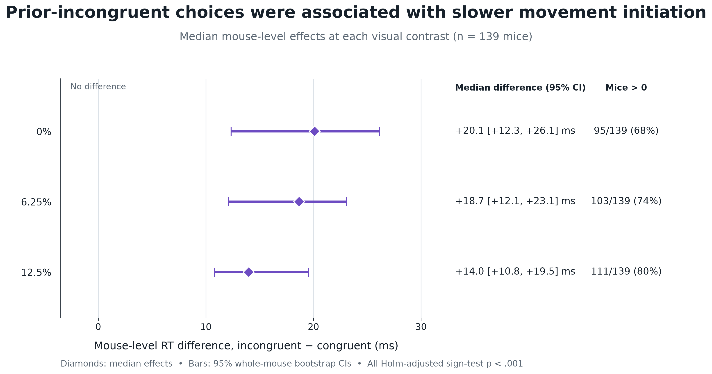

# Reaction time and prior-choice congruency

## Behavioral question

**Are prior-congruent choices initiated faster than prior-incongruent choices when visual evidence is absent or weak?**

Across 139 mice and 459 sessions, prior-incongruent choices were associated with slower movement initiation at 0%, 6.25%, and 12.5% visual contrast. The median paired delays were 20.1 ms, 18.7 ms, and 14.0 ms, respectively. Every whole-mouse bootstrap 95% confidence interval excluded zero.



| Visual contrast | Median paired difference | 95% bootstrap CI | Mice with positive difference |
|---|---:|---:|---:|
| 0% | +20.1 ms | [+12.3, +26.1] ms | 95/139 (68%) |
| 6.25% | +18.7 ms | [+12.1, +23.1] ms | 103/139 (74%) |
| 12.5% | +14.0 ms | [+10.8, +19.5] ms | 111/139 (80%) |

All two-sided exact sign tests remained significant after Holm correction (`p < .001`). The numerical reduction from 20.1 to 14.0 ms should not be interpreted as a contrast-dependent trend: a repeated-measures Friedman test did not find evidence that the effect differed across contrasts (`χ² = 1.68`, `p = .431`).

## Definitions

- **Prior-congruent choice:** the mouse chose the side favored by the current block prior.
- **Prior-incongruent choice:** the mouse chose the side opposite the current block prior.
- **Reaction time:** first detected movement time minus stimulus onset time.
- **Paired effect:** prior-incongruent RT minus prior-congruent RT. Positive values indicate slower prior-incongruent movement initiation.

The analysis includes trials at absolute visual contrasts of 0%, 6.25%, and 12.5% with a defined block prior, a completed left or right choice, and a reaction time greater than 0 and no greater than 2 seconds.

Congruent and incongruent trial counts are not equal:

| Visual contrast | Prior-congruent trials | Prior-incongruent trials |
|---|---:|---:|
| 0% | 12,067 | 5,801 |
| 6.25% | 25,682 | 9,480 |
| 12.5% | 28,173 | 8,668 |

Pairing does not require equal trial counts. Each condition is summarized separately within a session, and every one of the 139 mice has both conditions at all three contrasts.

## Analysis

The mouse is the independent statistical unit:

1. Compute the median RT for each condition within each session and contrast.
2. Compute the paired session difference: incongruent median minus congruent median.
3. Average session-level summaries within each mouse.
4. Report the median paired difference across mice.

Confidence intervals resample whole mice. Directional consistency is tested with two-sided exact sign tests and Holm correction across the three contrasts. A Friedman test evaluates whether paired effects differ across contrasts.

In the detailed paired figure, each grey line connects the two condition summaries from the same mouse. Red dotted lines and diamonds show the two separate cohort condition medians and are descriptive. Their endpoint difference is not generally the median paired effect. The lower purple diamond is the primary median of the mouse-level paired differences.

## Run the project

Python 3.12 is the tested environment.

```bash
python3.12 -m venv .venv
source .venv/bin/activate
python -m pip install -r requirements.txt
jupyter lab
```

Run the notebooks in order:

1. [`notebooks/reaction_time_analysis.ipynb`](notebooks/reaction_time_analysis.ipynb) validates the data, builds the hierarchical summaries, and exports descriptive results.
2. [`notebooks/reaction_time_results.ipynb`](notebooks/reaction_time_results.ipynb) loads the authoritative mouse summary, runs inference, and exports presentation figures.

The committed processed dataset supports a fully offline analysis. Set `REFRESH_DATA = True` only when intentionally rebuilding it from the IBL sources.

## Repository structure

```text
data/
├── README.md
├── download_status.csv
└── reaction_time_trials.parquet
notebooks/
├── reaction_time_analysis.ipynb
└── reaction_time_results.ipynb
results/
├── analysis/
│   ├── figures/
│   └── tables/
└── inference/
    ├── figures/
    ├── tables/
    └── README.md
```

Optional per-mouse diagnostic figures are regenerated under `results/generated/` and are not versioned.

## Interpretation and limitations

The findings describe an association between choice congruency and movement-initiation time; they do not establish a causal effect of the prior. Conclusions are limited to the included IBL Brain-Wide Map cohort, selected low contrasts, and the stated RT definition and filtering threshold.

## Data source and credit

Data are derived from the [International Brain Laboratory](https://www.internationalbrainlab.com/) Brain-Wide Map release. Please credit the IBL and cite:

- International Brain Laboratory, [*A brain-wide map of neural activity during complex behaviour*](https://doi.org/10.1038/s41586-025-09235-0).
- International Brain Laboratory, [*Brain-wide representations of prior information in mouse decision-making*](https://doi.org/10.1038/s41586-025-09226-1).

The source dataset is available through the [IBL Brain-Wide Map Open Data Registry](https://registry.opendata.aws/ibl-brain-wide-map/) under CC BY 4.0. Processing and provenance details are documented in [`data/README.md`](data/README.md).
